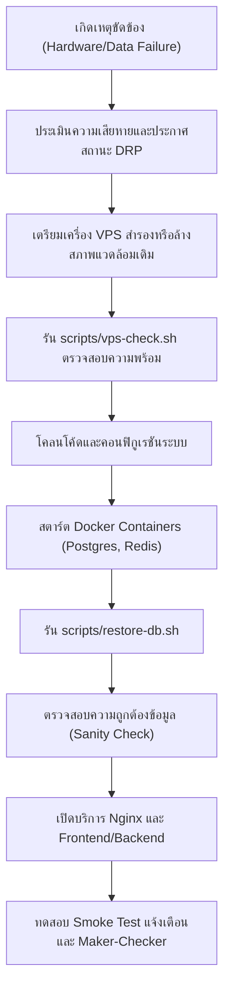

# แผนกู้คืนระบบจากภัยพิบัติ (Disaster Recovery Plan - DRP)
## ระบบ RYCOOP Smart Finance Enterprise

---

### 1. วัตถุประสงค์และเป้าหมายการกู้คืน (Objectives & Targets)
แผนกู้คืนระบบนี้จัดทำขึ้นเพื่อรองรับเหตุการณ์ไม่คาดคิด เช่น ฮาร์ดแวร์ VPS เสียหาย, ข้อมูลถูกทำลาย, หรือระบบเครือข่ายล่ม โดยกำหนดดัชนีชี้วัดดังนี้:
- **RTO (Recovery Time Objective):** ไม่เกิน **30 นาที** ในการนำระบบสำรองกลับมาให้บริการ
- **RPO (Recovery Point Objective):** ข้อมูลสูญหายได้ไม่เกิน **1 ชั่วโมง** (อ้างอิงจากรอบการบันทึก WAL และ Daily Snapshot)

---

### 2. นโยบายการสำรองข้อมูล (Backup Strategy)
1. **ฐานข้อมูล PostgreSQL (Production/Test):**
   - **Automated Daily Dump:** สคริปต์ `scripts/backup-db.sh` ทำงานอัตโนมัติทุกวันเวลา 01:00 น.
   - **Compression & Hash:** บีบอัดไฟล์ด้วย `gzip` และสร้าง `SHA256 Checksum` เพื่อตรวจสอบความครบถ้วน
   - **Retention Period:** จัดเก็บบนเครื่อง Local 14 วัน และโอนย้ายไปยัง Cloud Cold Storage (เช่น S3/MinIO) 90 วัน
2. **ไฟล์คอนฟิกูเรชันและ Secrets:**
   - เก็บไฟล์ `.env` และ Nginx SSL Certificates ในรูปแบบเข้ารหัสด้วย GPG หรือ Vault

---

### 3. ขั้นตอนการกู้คืนระบบกรณีฉุกเฉิน (Step-by-Step Restoration Drill)



#### คำสั่งสำหรับการกู้คืนฐานข้อมูล:
```bash
# 1. ตรวจสอบไฟล์สำรองล่าสุด
ls -lt /var/backups/rycoop/

# 2. รันคำสั่ง Restore Drill
bash scripts/restore-db.sh /var/backups/rycoop/rycoop_db_20261116_010000.sql.gz

# 3. ตรวจสอบความพร้อมของบริการ
docker compose ps
docker compose logs --tail=100 backend
```

---

### 4. บทบาทหน้าที่ของทีมกู้ภัยพิบัติ (Incident Team Roles)
| ตำแหน่ง | ความรับผิดชอบหลัก |
|---|---|
| **Incident Commander** | ตัดสินใจประกาศใช้แผน DRP และประสานงานผู้บริหารสหกรณ์ |
| **Database Administrator (DBA)** | ดึงไฟล์สำรอง ตรวจสอบ Checksum และรันสคริปต์ Restore |
| **DevOps / Infra Engineer** | ตรวจสอบ VPS, จัดเตรียม Docker Network และ SSL/TLS |
| **Finance Application Lead** | ทำการทดสอบธุรกรรมทางการเงินและตรวจสอบยอดกระทบยอด (Reconciliation) |

