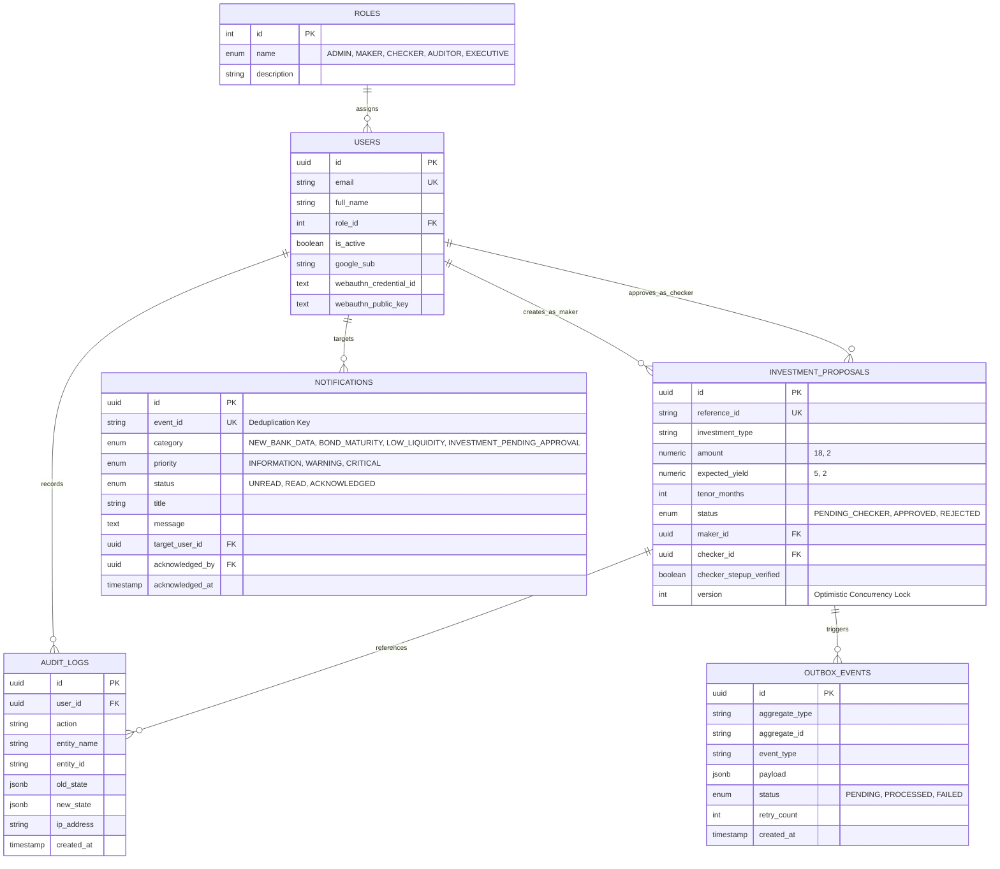

# Database Architecture & Migration Specification
## PostgreSQL 16 Schema for Savings Cooperative Governance

---

## 1. Entity Relationship Overview



---

## 2. Integrity Constraints & Concurrency Controls

1. **Row-Level Lock:** Approvals lock the target row via `SELECT ... FOR UPDATE` ensuring single-threaded resolution per investment record.
2. **Segregation of Duties Constraint:**
   ```sql
   CONSTRAINT chk_maker_checker_segregation CHECK (maker_id != checker_id OR checker_id IS NULL)
   ```
3. **Event Deduplication Constraint:**
   `event_id` in `notifications` is constrained by a `UNIQUE` index.
4. **Optimistic Versioning:**
   The `version` integer in `investment_proposals` is incremented on every state transition to detect concurrent writes.
