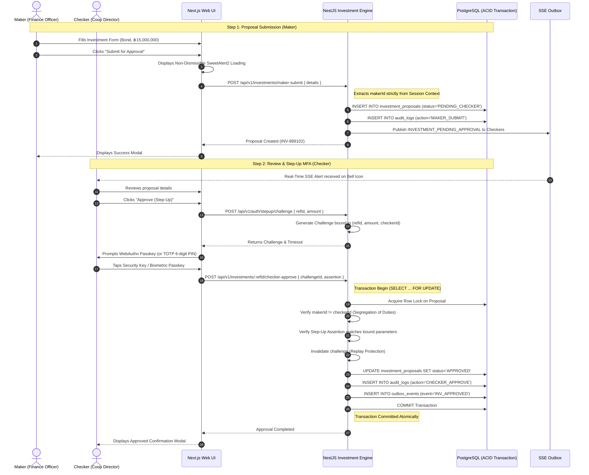

# Maker–Checker Investment Approval Workflow
## Dual-Control Governance & Transaction-Bound Step-Up MFA

---

## 1. Sequence Diagram: Dual-Control Approval Flow

---

## 2. Mathematical Integrity & Accounting Separation Rules

1. **No Overdraft as Cash:** Overdraft facility is recorded as contingent credit lines, never as cooperative cash or liquid reserves.
2. **Deterministic Calculations:** Bond carrying value, accrued interest, and weighted average yields are calculated using deterministic standard formulas with exact rounding rules.
3. **No Zero Defaults for Missing Data:** Sources that have not yet transmitted balances are marked as `PENDING_DATA` rather than assumed to be zero.
