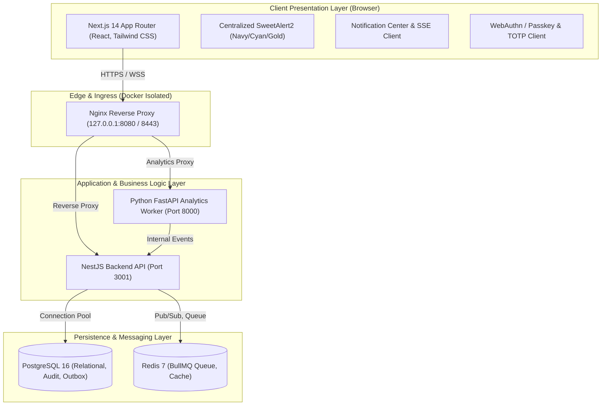

# System Architecture Specification
## RYCOOP Smart Finance Enterprise Platform

---

## 1. High-Level Architecture Overview

RYCOOP Smart Finance is designed specifically for savings and credit cooperatives (สหกรณ์ออมทรัพย์) to manage treasury, liquidity, investments, and regulatory compliance. It enforces strict separation of duties, defense-in-depth security, and high reliability.

---

## 2. Component Descriptions

### 2.1 Presentation Layer (Frontend)
- **Framework:** Next.js 14 App Router with TypeScript.
- **Styling:** Custom Tailwind CSS theme tailored in Navy Blue (`#0B192C`), Cyan (`#00ADB5`, `#38BDF8`), and Gold (`#F1C40F`, `#D4AF37`) with full Light/Dark mode.
- **Alerts:** Centralized SweetAlert2 service providing accessible, non-dismissible transaction modals during save operations.
- **Real-Time Client:** Persistent EventSource connection with heartbeat handling, exponential backoff, and event deduplication.

### 2.2 Ingress & Security Proxy
- **Containerized Nginx:** Listens locally on `127.0.0.1:8080` (HTTP) and `127.0.0.1:8443` (HTTPS) to **strictly avoid port collisions** with the existing live cooperative web server on ports 80/443.
- **Security Headers:** Strict Transport Security (HSTS), X-Content-Type-Options: nosniff, X-Frame-Options: DENY, Referrer-Policy, and Content Security Policy.
- **SSE Buffering Disabled:** `proxy_buffering off; chunked_transfer_encoding off;` for uninterrupted event streaming.

### 2.3 Backend API (NestJS)
- **Session Management:** Secure server-managed sessions using HttpOnly, Secure, SameSite=Strict cookies with idle and absolute expiration.
- **Maker-Checker Engine:** State machine ensuring proposal creation and approval require distinct identities and cryptographic Step-Up assertions.
- **Transactional Outbox:** Financial state and notification events are persisted atomically within PostgreSQL transactions.

### 2.4 Analytics Worker (FastAPI)
- Evaluates Liquidity Coverage Ratios (LCR) and tracks bond maturity schedules (30, 15, 7, 1 days).
- Emits pre-validated events to the NestJS internal event dispatcher via shared internal secrets.
