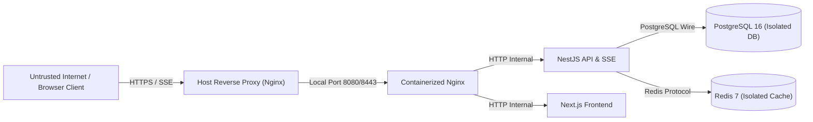

# Threat Model & Risk Analysis (STRIDE)
## RYCOOP Smart Finance Enterprise Platform

---

## 1. Scope & System Boundaries

The scope covers the TEST environment deployment of RYCOOP Smart Finance on a dedicated VPS network alongside an existing live cooperative web application.

---

## 2. STRIDE Analysis Matrix

| Threat Category | Potential Attack Vector | Impact | Mitigation in RC01 |
|---|---|---|---|
| **Spoofing (S)** | An attacker fakes a Google identity or passes an arbitrary `checkerUserId` | Unauthorized approval of cooperative funds | Google OIDC exact domain check (`@rycoop.coop`), local allowlist, server-side session derivation only. |
| **Tampering (T)** | Attacker alters proposal amount after Step-Up challenge is issued | Diverting excess cooperative cash | Transaction-bound challenge incorporates proposal ID, amount, and Checker ID cryptographically. |
| **Repudiation (R)** | Checker denies approving a multi-million baht bond transaction | Legal and regulatory dispute | Immutable audit log record with timestamp, IP, user ID, and cryptographic assertion evidence. |
| **Information Disclosure (I)** | Unauthenticated user connects to SSE stream or reads notifications with full account numbers | Bank account leakage | SessionAuthGuard on SSE stream, Default-Deny role filtering, automated account number masking (`xxx-x-xx56789-0`). |
| **Denial of Service (D)** | Brute force attacks on Step-Up MFA or port collisions with live Production Nginx | System outage / lockouts | Test ports moved to 8080/8443 (zero impact on Prod 80/443), Nginx rate limiting (10 req/min on auth), 5-attempt MFA lockout. |
| **Elevation of Privilege (E)** | Maker approves own proposal or Admin bypasses Maker-Checker flow | Insider fraud | Hard backend segregation (`makerId != checkerId`), Admin cannot inherit Maker/Checker roles. |
